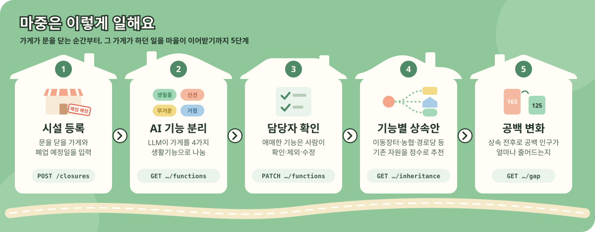
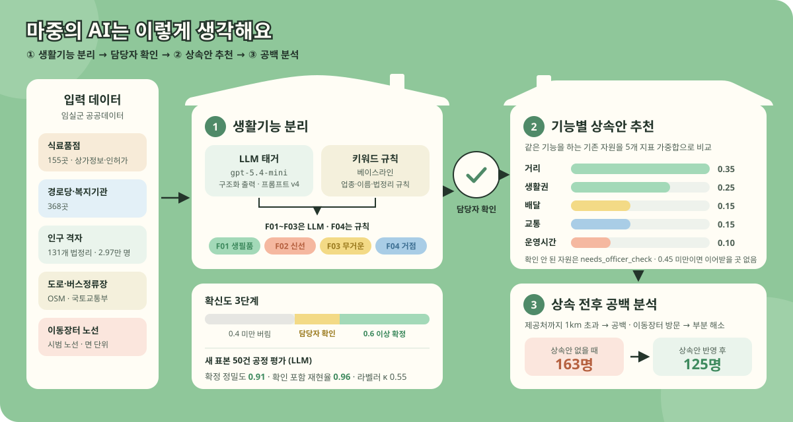
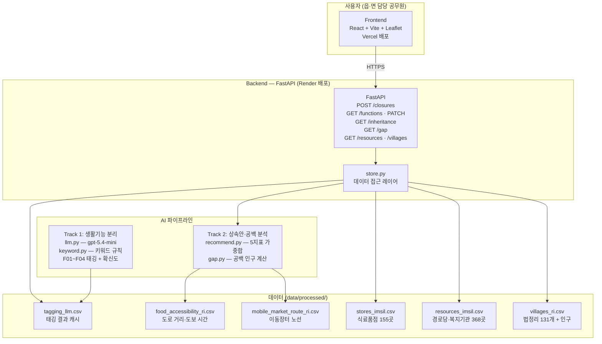
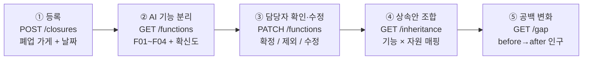
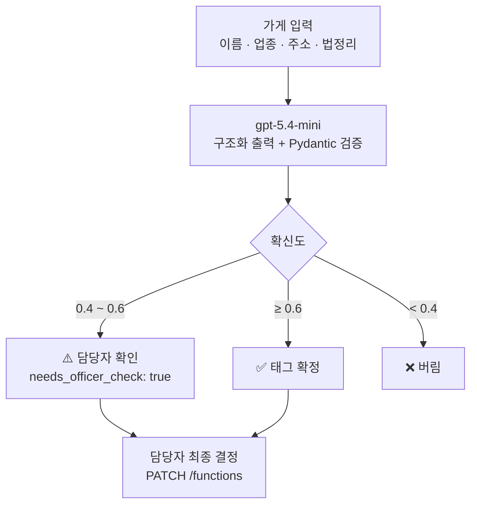
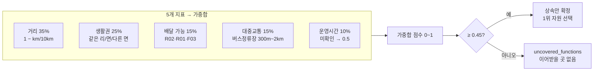

# 마중 (MAJUNG)

> **가게가 떠난 자리, 마을이 마중 나와요.**
> 농촌의 마지막 식료품점이 문을 닫을 때, 그 가게가 하던 생활기능을 마을의 기존 자원에 이어주는 AI 지역상생 서비스
>
> 2026 AI 라이프 솔루션 챌린지 출품작 · 원 아이디어: 2026 AI 라이프 아이디어 챌린지 「기능상속」

| 바로가기 | 주소 |
|---|---|
| 서비스 (웹) | https://majung.store |
| API 문서 (Swagger) | https://gineung-sangsok-api.onrender.com/docs |
| 시연 시나리오 | 대시보드 → 마을 지도의 「기능 상속 보기」 → 기능 분석 → 상속안 → 최종 검토 |
| AI 데이터셋·샘플 결과 | [docs/ai_dataset_and_results.md](docs/ai_dataset_and_results.md) |

> 백엔드는 무료 서버라 첫 요청에 30초 정도 걸릴 수 있어요.

---

## 1. 왜 필요한가

전북 임실군 131개 법정리 가운데 **102곳(77.9%)에는 식료품점이 없습니다.** 가장 가까운 식료품점까지 도로 거리 중앙값은 **2.2km**, 걸어서 평균 **44분**입니다. 인구 2만 9,699명 중 65세 이상이 **36.2%** 입니다. (`data/processed/` 분석 결과)

이런 마을에서 마지막 가게가 문을 닫으면 사라지는 것은 가게 하나가 아닙니다.
라면·휴지를 사던 곳, 채소를 사던 곳, 쌀을 배달받던 곳, 이웃 소식을 듣던 곳이 **한꺼번에** 사라집니다.

지금까지의 대응은 "대체 가게를 어디에 둘까"였습니다. 마중은 질문을 바꿉니다.

> **"그 가게가 하던 생활기능 하나하나를, 마을의 누가 이어받을 수 있을까?"**

이동장터, 농협 배송, 경로당, 복지기관처럼 **이미 있는 자원**에 기능을 나눠 맡기면, 새 시설을 짓지 않고도 공백을 줄일 수 있습니다.

## 2. 무엇을 하나

시·군, 읍·면 담당 공무원(B2G)이 쓰는 의사결정 지원 서비스입니다.

<p align="center"></p>

| 단계 | 하는 일 | 화면 / API |
|---|---|---|
| ① 등록 | 문을 닫을 가게와 날짜를 등록 | 시설 등록 · `POST /closures` |
| ② 기능 분리 | AI가 가게를 4가지 생활기능으로 나누고 확신도·근거를 붙임 | 기능 분석 · `GET /closures/{id}/functions` |
| ③ 확인·수정 | 담당자가 AI 결과를 확인·제외·수정 | 기능 분석 · `PATCH /closures/{id}/functions` |
| ④ 상속안 | 기능마다 이어받을 기존 자원을 점수로 비교해 추천 | 상속안 · `GET /closures/{id}/inheritance` |
| ⑤ 공백 변화 | 상속안을 반영하기 전후로 공백 인구가 얼마나 줄어드는지 계산 | 최종 검토·대시보드 · `GET /closures/{id}/gap` |

### 생활기능 체계

| 코드 | 기능 | 판단 기준 |
|---|---|---|
| F01 | 생필품 구매 | 공산품·가공식품 판매 |
| F02 | 신선식품 구매 | 채소·과일·정육·수산·유제품 |
| F03 | 무거운 상품 구매 | 쌀·생수·연료 등, 또는 배달 |
| F04 | 마을 생활거점 | 공동수령·모임·안부 확인 장소 |

이어받는 자원은 R01 이동장터 · R02 농협·지역마트 배송 · R03 마을회관·경로당 · R04 복지기관 · R05 인근 상점으로 나눕니다. ([docs/contracts/function_taxonomy.md](docs/contracts/function_taxonomy.md))

### 설계 원칙

- **AI는 폐업을 예측하지 않습니다.** 이미 발생했거나 예정된 폐업 이후의 대안만 제안합니다.
- **AI가 결정하지 않습니다.** 애매한 판단은 "담당자 확인"으로 넘기고, 최종 결정은 담당자가 합니다.
- **가장 가까운 곳만 고르지 않습니다.** 생활권·배달·교통·운영시간을 함께 봅니다.
- **데이터의 한계를 숨기지 않습니다.** 공공데이터가 실제와 다를 수 있는 부분(가정 노선, 운영시간 없음)은 화면과 응답에 그대로 표시합니다.

---

## 3. AI 모델

마중의 AI는 세 부분으로 이루어집니다.

<p align="center"></p>

### 3-1. 생활기능 분리 (LLM 태거)

| 항목 | 내용 |
|---|---|
| 모델 | OpenAI `gpt-5.4-mini-2026-03-17` (날짜 스냅샷으로 고정) |
| 입력 | 가게·자원의 이름, 업종(또는 자원 종류), 주소, 법정리, 같은 법정리의 영업 식료품점 수 |
| 출력 | 기능 코드별 `confidence`(0~1)와 근거 문장 — 구조화 출력 + Pydantic 검증으로 형식 강제 |
| 확신도 3단계 | **0.6 이상 확정** · **0.4~0.6 담당자 확인** · 0.4 미만 버림 |
| 프롬프트 | [track1_tagging/prompts/v4.md](track1_tagging/prompts/v4.md) (v1→v4, 오류 사례 분석으로 개선) |
| 캐시 | (프롬프트 버전·본문, 모델, 입력)의 해시로 결과를 저장해 같은 입력은 다시 부르지 않음 |
| 실행 규모 | 가게 152곳 + 자원 368곳 전체를 병렬 8로 약 80초에 태깅 (입력 약 64만 토큰) |

**프롬프트를 어떻게 다듬었나** ([docs/experiments/tagging_prompt.md](docs/experiments/tagging_prompt.md))
- v1→v2: 작은 슈퍼에 무거운 상품을 과신하는 패턴 → 업종별 기준과 "확실하지 않으면 0.6 미만" 원칙 추가
- v2→v3: 고속도로 휴게소 편의점·치즈 특산물 판매장 오판 → 실제 이름 예시로 보강
- v3→v4: 두 라벨러의 기준 합의(건어물·다이소·치즈·휴게소 편의점) 반영
- 같은 표본으로 더 다듬으면 과적합만 커지므로 v4에서 멈춤

**베이스라인: 키워드 규칙** ([track1_tagging/keyword.py](track1_tagging/keyword.py))
업종·이름 키워드 규칙으로 같은 형식의 태그를 만듭니다. 마을 생활거점(F04)은 "같은 법정리에 영업 중인 식료품점이 이곳뿐"이라는 규칙이 정확해서 서비스에서는 **F01~F03은 LLM, F04는 규칙** 결과를 씁니다.

### 3-2. 평가 — 튜닝에 쓰지 않은 표본으로 공정하게

프롬프트를 다듬은 표본(sample50)으로 평가하면 점수가 부풀려집니다. 그래서 **튜닝에 쓰지 않은 새 표본 50건(eval50)** 을 두 사람이 독립적으로 라벨링하고, 갈린 칸을 라벨링 가이드([docs/labeling_guide.md](docs/labeling_guide.md))로 합의해 정답을 만들었습니다.

- 라벨러 간 일치도(코헨 카파): 전체 **0.55** (F04 0.87 · F02 0.45 · F01 0.38 · F03 0.14)

| 방법 | 기준 | 정밀도 | 재현율 | F1 |
|---|---|---|---|---|
| 키워드 규칙 | 확정(0.6↑) | 0.79 | 0.69 | 0.74 |
| 키워드 규칙 | 확인 포함(0.4↑) | 0.75 | 0.85 | 0.79 |
| **LLM v4** | 확정(0.6↑) | **0.91** | 0.61 | 0.73 |
| **LLM v4** | 확인 포함(0.4↑) | 0.65 | **0.96** | 0.77 |

**해석**
- LLM은 **확정한 태그가 잘 틀리지 않고(정밀도 0.91)**, 애매하면 "확인 필요"로 내려 **놓치는 기능이 거의 없습니다(재현율 0.96)**. 담당자 확인 단계가 있는 서비스 설계와 맞습니다.
- 튜닝 표본에서의 F1 0.90은 새 표본에서 0.73으로 떨어졌습니다. 과대평가를 걷어 낸 정직한 숫자를 씁니다.
- 무거운 상품(F03)은 정답 양성이 2건뿐이라 표본을 늘려야 제대로 평가할 수 있습니다.

### 3-3. 기능별 상속안 추천

기능마다 같은 기능을 하는 기존 자원을 후보로 모으고, 5가지 점수(0~1)의 가중합으로 순위를 매깁니다. ([track2_recommend/recommend.py](track2_recommend/recommend.py), [docs/experiments/inheritance_scoring.md](docs/experiments/inheritance_scoring.md))

| 점수 | 가중치 | 계산 |
|---|---|---|
| 거리 | 0.35 | 1 − 거리/10km (이동장터는 마을로 찾아오므로 1) |
| 생활권 | 0.25 | 같은 리 1 · 같은 면 0.7 · 다른 면 0.3 |
| 배달 | 0.15 | 농협 배송·이동장터·무거운 상품 배달 근거 → 1 |
| 교통 | 0.15 | 후보 마을의 가까운 버스정류장 300m → 1, 2km → 0 |
| 운영시간 | 0.10 | 정보가 없으면 0.5 + 담당자 확인 |

- 후보 태그가 "확인 필요"이거나, 이동장터처럼 노선이 확인되지 않은 자원은 `needs_officer_check: true`
- 1위 점수가 기준(0.45)보다 낮으면 "이어받을 곳 없음(uncovered)"으로 알려 줍니다
- 추천 사유는 거리·생활권·강점·근거를 담은 문장으로 함께 돌려줍니다

### 3-4. 상속 전후 공백 분석

폐업 가게가 **가장 가까운 제공처였던 마을**마다, 상속안을 반영하기 전과 후의 제공처·거리·공백 여부를 계산합니다. ([track2_recommend/gap.py](track2_recommend/gap.py), [docs/experiments/gap_calc.md](docs/experiments/gap_calc.md))

- 공백 판정: 제공처까지 1km 초과 → 공백 · 이동장터 방문 → 부분 해소 (신선식품은 판매 품목 확인 전까지 해소로 보지 않음)
- 공백 인구: 기능별 공백 마을 인구의 평균 (일부 기능만 해소돼도 변화가 보이도록)

**시연 결과 — 덕치면 일중리 천일슈퍼가 문을 닫는다면**

| 기능 | 이어받는 곳 | 결과 |
|---|---|---|
| 생필품 | 임실 이동장터 (덕치면) | 부분 해소 · 노선 확인 필요 |
| 신선식품 | 임실 이동장터 (덕치면) | 판매 품목 확인 전까지 공백 |
| 무거운 상품 | 임실농협하나로마트 덕치점 (2.6km) | 배송 연계 시 해소 가능 |
| 마을 생활거점 | 일중경로당 (같은 마을 0.5km) | 해소 |

→ 기능 평균 공백 인구 **163명 → 125명 (23% 감소)**

---

## 4. 데이터

| 데이터 | 출처 | 규모 |
|---|---|---|
| 식료품점 | 소상공인시장진흥공단 상가정보 · 지방행정 인허가(LOCALDATA) | 155곳 (영업 152) |
| 경로당·복지기관 | 전북특별자치도 경로당 현황 · 임실군 노인복지시설 현황 (공공데이터포털) | 368곳 (경로당 350, 복지기관 18) |
| 인구 | 통계청 SGIS 100m 격자 → 법정리 집계 | 131개 법정리, 29,699명 |
| 도로·교통 | OpenStreetMap 도로망 · 국토교통부 버스정류장 현황 | 법정리별 정류장·식료품점 도로 거리 |
| 이동장터 | 언론 보도 (2026-02 시범 · 2026-09 정식) | 임실읍 시범 노선 법정리 단위, 그 밖은 면 단위 |
| 경계·지오코딩 | LX 법정구역경계 · 브이월드 지오코더 | 131개 법정리 경계, 주소 → 좌표 |

모든 데이터의 출처·수집일·이용 조건은 [docs/data_sources.md](docs/data_sources.md)에 기록합니다. 원본(`data/raw/`)은 저장소에 올리지 않고, 정제 결과만 `data/processed/`에 둡니다.

---

## 5. 코드 구조

```
.
├── track1_tagging/          # AI ① 생활기능 분리
│   ├── llm.py               #   LLM 태거 (구조화 출력·캐시, 모든 호출이 한 함수를 거침)
│   ├── keyword.py           #   키워드 규칙 베이스라인
│   ├── schema.py            #   기능 태그 형식·확신도 기준
│   └── prompts/v1~v4.md     #   프롬프트 버전
├── track2_recommend/        # AI ② 상속안 추천 · ③ 공백 분석
│   ├── recommend.py         #   후보 점수화·선택
│   └── gap.py               #   상속 전후 공백 계산
├── backend/                 # FastAPI (main.py 라우터, store.py 데이터 접근, schemas.py 계약 형식)
├── frontend/                # React + Vite + Leaflet (랜딩, 마을 지도, 대시보드, 등록·분석·상속안·검토 화면)
├── scripts/                 # 데이터 수집·정제·지오코딩, 태깅 실행(run_tagging.py), 평가(evaluate_tagging.py)
├── data/
│   ├── processed/           #   정제·분석 결과, 태깅 결과
│   └── labels/              #   평가용 정답 라벨 (sample50, eval50, 라벨러별·합의본)
├── tests/                   # pytest (태깅·추천·공백·API·공간 분석)
└── docs/
    ├── contracts/           #   기능 체계, 태깅 형식, 공간 데이터 형식, API 명세
    ├── experiments/         #   태깅·추천·공백 실험 기록
    ├── labeling_guide.md    #   정답 라벨 기준
    └── data_sources.md      #   데이터 출처
```

## 6. 구조 다이어그램

### 전체 시스템 구조



### 서비스 흐름



### AI 태깅 확신도 3단계



### 상속안 점수 계산



---

## 7. 실행 방법

```bash
# 준비 (uv: https://docs.astral.sh/uv/)
uv sync
cp .env.example .env          # OPENAI_API_KEY, OPENAI_MODEL 등 입력 (.env는 커밋하지 않음)

# 린트·테스트
uv run ruff check .
uv run pytest

# AI ① 생활기능 태깅 (전체 / 평가용 표본)
uv run python scripts/run_tagging.py --method all --prompt v4
uv run python scripts/run_tagging.py --method all --prompt v4 --sample 50 --name eval50 \
    --seed 7 --store-ratio 0.8 --exclude data/labels/sample50.csv --labelers A B

# 평가: 라벨러 간 일치도 → 정답 평가
uv run python scripts/evaluate_tagging.py --agreement data/labels/eval50_A.csv data/labels/eval50_B.csv
uv run python scripts/evaluate_tagging.py --labels data/labels/eval50.csv

# 백엔드 (http://localhost:8000/docs)
uv run uvicorn backend.main:app --reload

# 프론트엔드 (http://localhost:5173)
cd frontend && npm ci && npm run dev
```

`closure_0001`(덕치면 일중리 천일슈퍼)이 데모로 미리 등록돼 있어 바로 조회할 수 있습니다. LLM 결과는 캐시와 `data/processed/tagging_*.csv`로 저장돼 있어, 서비스 실행에는 OpenAI 키가 필요하지 않습니다.

### API

| 메서드 | 경로 | 설명 |
|---|---|---|
| POST | `/closures` | 폐업 예정 시설 등록 |
| GET | `/closures/{id}/functions` | AI 생활기능 분리 결과 |
| PATCH | `/closures/{id}/functions` | 담당자 확인·수정 저장 |
| GET | `/closures/{id}/inheritance` | 기능별 상속안과 추천 사유 |
| GET | `/closures/{id}/gap` | 상속 전후 공백 인구 변화 |
| GET | `/resources` · `/villages` | 지도용 자원·마을 데이터 |

자세한 형식은 [docs/contracts/api_spec.md](docs/contracts/api_spec.md)와 배포된 [Swagger 문서](https://gineung-sangsok-api.onrender.com/docs)를 참고하세요.

## 7. 한계와 다음 단계

| 한계 | 지금의 처리 | 다음 단계 |
|---|---|---|
| 이동장터 정식 노선(38개 법정리) 명단 비공개 | 공개된 시범 노선만 법정리 단위 반영, 나머지는 "가정 노선" 표시 | 정보공개청구로 노선 확보 |
| 상점 운영시간 데이터 없음 | 중간값 + 담당자 확인 | 군청 인허가·현장 조사 데이터 연계 |
| 거리 일부가 직선거리 | 법정리 대표점 기준 | 기능별 도로 거리 계산 |
| 무거운 상품(F03) 평가 표본 부족 | 정답 양성 2건 | 평가 표본 보강 |
| 추천 사유가 문장 템플릿 | 점수·근거 기반 | LLM 추천 사유 생성 |

## 8. 팀

| | 역할 |
|---|---|
| [@JioCoder](https://github.com/JioCoder) | 트랙 1 · 생활기능 분리 AI(LLM·키워드·평가), 상속안 추천·공백 분석, 백엔드 API, 프론트 디자인 |
| [@heejung72](https://github.com/heejung72) | 트랙 2 · 인구·교통 공간 분석, 지도·대시보드·상속안 화면 및 API 연동, 백엔드 API, 프론트·백엔드 배포 |

협업 방식(이슈 → 브랜치 → PR → 리뷰)은 [docs/workflow.md](docs/workflow.md)에 있습니다.
